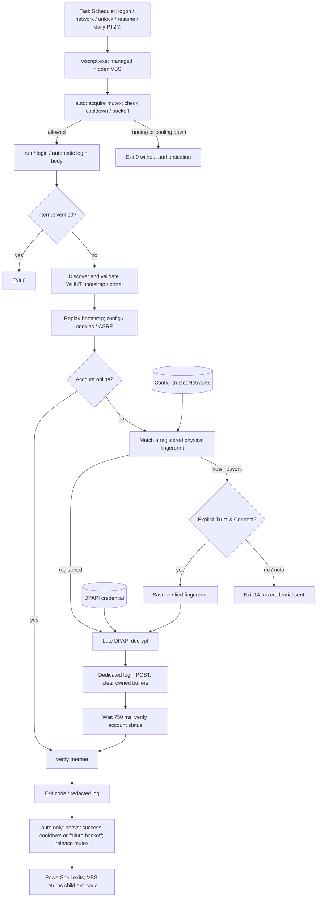

# Architecture evidence — Windows v1.5.0

The marked Mermaid block below is the maintained diagram source. It describes the current single-file Windows client, including bootstrap/cookie setup, registered physical fingerprints, late decryption and post-login verification. Android shares protocol and registration concepts but uses a selected Wi-Fi Network and Keystore; see [platform notes](../ANDROID.md).

Source reviewed for Windows v1.5.0 on 2026-10-23; the v1.4.0 review and historical field records retain their original dates. Anchors in [evidence.json](evidence.json) catch renamed/deleted symbols; they do not prove semantics. The diagram follows function call sites. The 750 ms verification delay is not a retry loop. Task Scheduler starts a finite process through a synchronous hidden VBS launcher, with five native triggers, not a daemon.

`Install-WhutScheduledTask` derives the script from `$PSCommandPath`, resolves PowerShell/WSH through `New-WhutTaskActionSpec`, builds `New-WhutTaskDefinition`, and validates its XML before preparing `Initialize-WhutLauncher`. The temporary UTF-16 launcher is checked and safely probed, then atomically moved into managed state before task registration. `Uninstall-Whut` removes the task before deleting that state; failure preserves the launcher and credential/config/log files. No authentication protocol or automatic trust enrollment changes.

The native daily trigger starts at installation-day local midnight and repeats `PT2M` for `P1D` every day (DaysInterval 1, no EndBoundary). The remaining triggers are current-user logon (`PT5S`), NetworkProfile/Operational 10000 (`PT3S`), current-user SessionUnlock (`PT3S`) and System Power-Troubleshooter 1 (`PT3S`). InteractiveToken/least privilege, IgnoreNew and the two-minute process limit remain. Exact settings and [COM reference links](#scheduler-references) are below; synthetic assertions and local COM validation do not establish device-event delivery.

## Lightweight verification

```powershell
pwsh -NoProfile -File tests/check-architecture.ps1
```

This verifies the authoritative diagram block, source anchors, local documentation links, PowerShell syntax and versioned help. It is the automatic documentation CI gate; README/docs changes do not install rendering toolchains or trigger Android builds.

## Optional historical renderer

The existing development-only Python/Node renderer from the earlier architecture documentation remains available manually:

```sh
python docs/architecture/verify.py --render
```

It extracts Mermaid, renders with pinned Mermaid CLI 11.12.0, checks SVG XML and compares deterministic repeated output in one toolchain. This optional check needs Python 3, Node.js and a browser; none is a WUTNet runtime dependency. It can also be requested through the architecture workflow's manual dispatch. GitHub browser appearance still needs visual review.

Historical note: the original architecture snapshot was reviewed at commit `5b18ed5`. Its README-only discovery aid was not treated as authoritative source analysis. The current diagram and evidence supersede that snapshot without importing generated artwork or private data.


## Overview

<!-- architecture:overview:start -->

<!-- architecture:overview:end -->

## Scheduler references

Microsoft documents [trigger enum values](https://learn.microsoft.com/en-us/windows/win32/api/taskschd/ne-taskschd-task_trigger_type2), [unlock state 8](https://learn.microsoft.com/en-us/windows/win32/api/taskschd/ne-taskschd-task_session_state_change_type), [session trigger properties](https://learn.microsoft.com/en-us/windows/win32/taskschd/sessionstatechangetrigger), [daily recurrence](https://learn.microsoft.com/en-us/windows/win32/taskschd/dailytrigger), [repetition duration and interval](https://learn.microsoft.com/en-us/windows/win32/taskschd/repetitionpattern), and [validation-only/create-or-update flags](https://learn.microsoft.com/en-us/windows/win32/taskschd/taskfolder-registertaskdefinition). The local Windows provider metadata for `Microsoft-Windows-Power-Troubleshooter`, EventID 1, describes a return from a low-power state; this was inspected on 2026-10-23 without sleeping the device. It does not guarantee the event is emitted for every standby mode.
