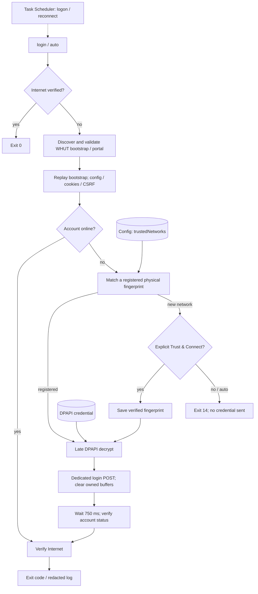

# Architecture evidence — Windows v1.4.0

The marked Mermaid block below is the maintained diagram source. It describes the current single-file Windows client, including bootstrap/cookie setup, registered physical fingerprints, late decryption and post-login verification. Android shares protocol and registration concepts but uses a selected Wi-Fi Network and Keystore; see [platform notes](../ANDROID.md).

Source reviewed for the v1.4.0 release on 2026-10-11. Anchors in [evidence.json](evidence.json) catch renamed/deleted symbols; they do not prove semantics. The diagram was checked against the function call sites. In particular, the 750 ms verification delay is not a retry loop, and Task Scheduler starts a finite process rather than a daemon.

## Lightweight verification

```powershell
pwsh -NoProfile -File tests/check-architecture.ps1
```

This verifies the authoritative diagram block, source anchors, local documentation links, PowerShell syntax and versioned help. It is the automatic documentation CI gate; README/docs changes do not install rendering toolchains or trigger Android builds.

## Optional historical renderer

The existing development-only Python/Node renderer from the earlier architecture documentation remains available manually:

```sh
python docs/architecture/verify.py --render
```

It extracts Mermaid, renders with pinned Mermaid CLI 11.12.0, checks SVG XML and compares deterministic repeated output in one toolchain. This optional check needs Python 3, Node.js and a browser; none is a WUTNet runtime dependency. It can also be requested through the architecture workflow's manual dispatch. GitHub browser appearance still needs visual review.

Historical note: the original architecture snapshot was reviewed at commit `5b18ed5`. Its README-only discovery aid was not treated as authoritative source analysis. The current diagram and evidence supersede that snapshot without importing generated artwork or private data.


## Overview

<!-- architecture:overview:start -->

<!-- architecture:overview:end -->
